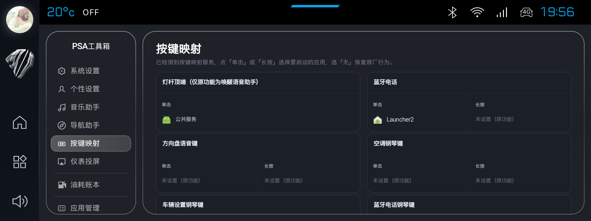
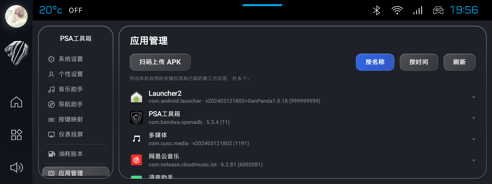
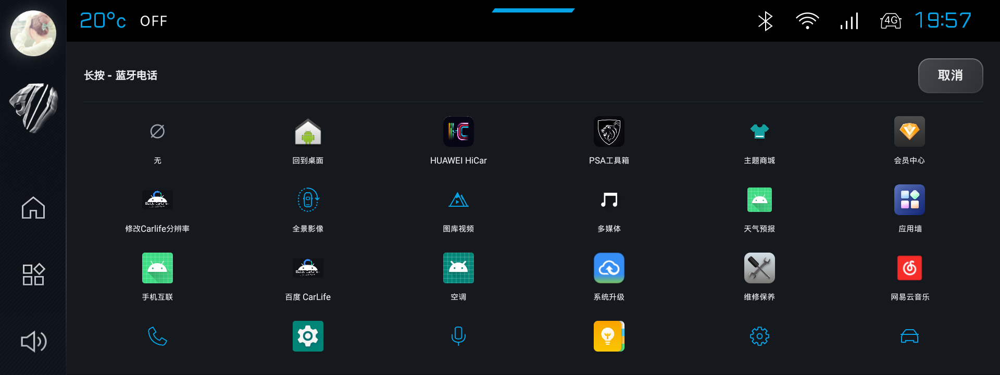
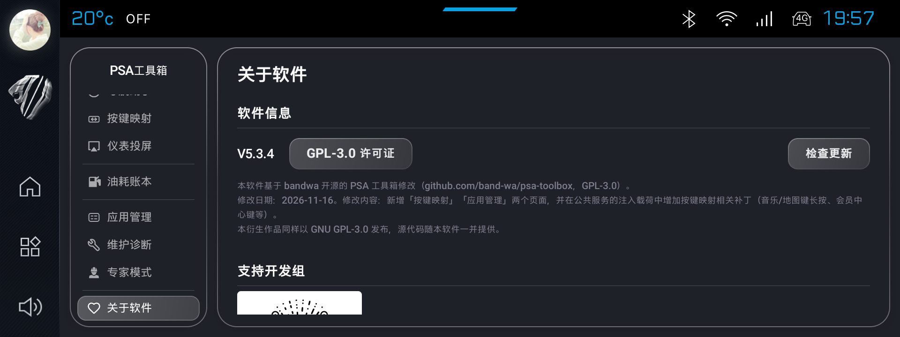

# 改动说明

> 本文件记录我们在 PSA 工具箱里做过的主要改动，供排查代码与写发布说明时查阅。
>
> 改动事实与日期记录在本文件。
>
> 最近一次更新：2026-11-16
>
> **已在实车验证**（2026-11-16，408 / `3VS121` / Android 9 / 1920x720），详细结果见本文第八节。

## 一、一句话概括

我们新增了「按键映射」「应用管理」两个页面，并把按键映射的注入载荷并入工具箱原有的 `修复PSA工具箱`（`ModApk`）链路 —— 一次「修复核心组件」就能同时装上音乐/地图补丁和新加的按键映射补丁。

## 二、改动规模

相对起点 commit `6f5c80f`：**69 个文件，+6,125 / −1,059 行**（新增 33 个文件）。

| 区域 | 文件数 | 变化 | 说明 |
| --- | --- | --- | --- |
| 注入载荷 `app/src/main/assets/modapk/com.cusc.misc/` | 9 | +657 / −1 | 我们新写的 8 个 smali 片段 + `config.json` 从 6 条 operation 扩到 11 条 |
| 按键映射页 `presentation/main/keymap/` | 4 | +581 | 新页面：13 个键位、两列布局、网格选应用 |
| 应用管理页 `presentation/main/apps/` | 3 | +648 | 新页面：应用列表、点行展开操作、扫码上传 APK |
| `core/.../util/` | 10 | +2,390 / −11 | 内存/存储清理、崩溃收集、系统信息、应用管理、boot 唤醒等 |
| `ui/` 组件与主题 | 13 | +607 / −225 | 玻璃拟态去阴影、Tab 分组、四级字号、双主题调色 |
| `service/` 注入与开机 | 4 | +229 / −72 | `ModApk` 三种新 operation、开机无界面唤醒、删重复长按 |
| 关于软件页 | 4 | +274 / −20 | 加了「检查更新」入口与版本号连点解锁；项目原有的版权行与致谢原样保留 |
| 其它页面 | 21 | +733 / −729 | 菜单重排、页面分组、删冗余项 |
| `hook/` | 1 | +6 / −1 | `Hook.VERSION` `"4"` → `"5"`（老车会因版本不一致自动提示重装） |

## 三、新增的 33 个文件

### 3.1 注入载荷（8 个 smali + 1 个改造过的 config.json）

| 文件 | 行数 | 作用 |
| --- | --- | --- |
| `psa_handle.smali` | 226 | `psaHandle(KeyEventEmitter, int keycode, boolean isLong)`：11 个键码的属性解析与启动分发 |
| `psa_launch.smali` | 133 | `psaLaunch(Context, String)`：解析 `包名/Activity` 并启动，失败回落原厂 |
| `psa_stopavm.smali` | 100 | `CarPropertyManager.stopAVMDisplay()`：原厂没有，用来关 360 |
| `psa_boot.smali` | 100 | `psaBoot(Context)`：开机 startService 拉起工具箱 + 清日志 + 开 WiFi |
| `psa_onkeyclick.smali` | 11 | 插进 `onKeyClick` 开头：调 `psaHandle(..., false)`，接管则 return |
| `psa_onkeylongclick.smali` | 11 | 插进 `onKeyLongClick` 开头：调 `psaHandle(..., true)` |
| `psa_d4g_off.smali` | 6 | 插进 `Data4gImpl.showNetState()` 开头：`return-void`，屏蔽「车机未连接到服务器」弹窗 |
| `psa_boot_ins.smali` | 2 | 插进 `BootReceiver.onReceive` 开头：调 `psaBoot` |

### 3.2 新页面

`keymap/`：`KeyMapRoute.kt`(148) `KeyMapCard.kt`(162) `KeyMapViewModel.kt`(243) `KeyMapUIState.kt`(28)
`apps/`：`AppsRoute.kt`(339) `AppsViewModel.kt`(285) `AppsUIState.kt`(24)
`tools/DiagSections.kt`(494)：运行状态 / 内存清理 / 存储清理 / 崩溃诊断 / 工程模式五段

### 3.3 core 工具

`MemGuard.kt`(690) `StorageClean.kt`(451) `CrashCollect.kt`(289) `SysInfo.kt`(253) `AppManage.kt`(200) `PsaExt.kt`(155) `AppPick.kt`(134) `BootWake.kt`(100)

### 3.4 UI 组件

`PageTitle.kt`(29) `SectionTitle.kt`(44) `AppPickDialog.kt`(158) `AppPickerTwoPane.kt`(163) `KeyPalette.kt`(39) `ic_apps.xml`(20) `ic_key_map.xml`(20)

### 3.5 测试

`service/src/test/.../PsaKeyMapPackTest.kt`(180)：打真包验证 11 条 operation 全部落下、方法体里真的调到了

## 四、改动已有代码的地方

- **`app/src/main/assets/modapk/com.cusc.misc/config.json`**：6 条 operation → 11 条。原有音乐/地图/`isBcallRunning` 三条一字未动，新增 KeyEventEmitter 4 条 + CarPropertyManager 1 + Data4gImpl 1 + BootReceiver 2。
- **`core/.../util/apktools/SmaliMod.kt`**：新增 `insertBeforeMethod` / `insertAfterRegisters` / `appendToClass` 三个方法。原有的 `DexInjector` 只能做 INVOKE_STATIC/IGET/SGET/CONST_STRING，表达不了「早退分支」。
- **`service/.../install/ModApk.kt`**：`applyModifications` 支持 `skipIfContains` 幂等键与三种新 type。
- **`service/.../service/PSAToolBoxService.kt`**：**删掉**音乐键(`"11"`)/地图键(`"13"`)长按的旧实现（走的 MCU 属性 `0x2141F04B` 通道），改由注入层统一接管，避免长按被启动两次。
- **`service/.../receiver/BootReceiver.kt`**：新增「不进界面（后台唤醒）」分支（`BootWake`），开机拉 APP 时可选不弹界面；清理动作从 `delay(10000)` 之后提前到 `user.sh` 之后立刻跑。
- **`ui/.../ui/Glassmorphism.kt`**：把大面积阴影拆成独立静态层。原来 `Modifier.shadow(8.dp)` 画在整页滚动容器上，内部任何变化都让该层失效，是滑动掉帧的主因。
- **`ui/.../component/ScrollableTabs.kt`**：Tab 加 group 分组、去逐项 alpha 动画、高度压到 44dp、去掉写死的 240dp 宽度。
- **`app/.../MainActivity.kt`**：Tab 顺序改为 系统设置 / 个性设置 / 音乐助手 / 导航助手 / 按键映射 / 仪表投屏 ‖ 油耗账本 ‖ 应用管理 / 维护诊断 / 专家模式 ‖ 关于软件。
- **`about/AboutSettingsRoute.kt`**：加了版本号连点解锁工程模式、以及贴着版本号的「检查更新」入口；赞赏码、贡献者头像、版权行与「特别感谢」原样保留。
- **`hook/.../Hook.java`**：`VERSION` `"4"` → `"5"`。

## 五、在线更新（本仓库的 `ota/` 目录）

用 GitHub raw 直链做分发，构建时把 `psa.otaBase` / `psa.infoBase` 指向它（见 `local.properties`，该文件不入库）：

```properties
psa.otaBase=https://raw.githubusercontent.com/C19991221/psa-toolbox-mapping/main/ota
psa.infoBase=https://raw.githubusercontent.com/C19991221/psa-toolbox-mapping/main/ota
```

目录结构与代码里的路径一一对应，说明见 `ota/README.md`，发版脚本 `ota/publish_ota.py`。

## 六、还没做的（如实记录）

- **实体空调键（风量/温度/AC）没有统一到注入载荷**。它们走的是 MCU 属性 `0x2141F04B` 通道，`com.cusc.misc` 侧**完全不注册**这个属性，事件根本收不到；要统一得让 misc 也注册该属性或改走 HVAC 属性直写，工作量大且未经实车验证，暂时仍归工具箱 `PSAToolBoxService`。
- **HiCar 与 CarLife 的修复包已从实车提取补齐**（`ota/tools/hicar/` 8,405,924 B / `11.5 fix2`；`ota/tools/carlife/` 7,295,261 B / `4.4.4 fix4`，含「修改 Carlife 分辨率」入口 `com.baidu.carlifevehicle/.SettingsActivity`）。**多媒体插件仍未补**（暂时没有可提取的修复版，界面入口已隐藏）。
- **沙发管家（应用市场）的下载地址没有配**（`psa.shafaEndpoint`）。本仓库上按钮已隐藏（`SHOW_INSTALL_MARKET = false`）。

## 七、界面截图

以下都是在实车（408 / `3VS121` / 1920x720 / density 213）上截的，位于 `docs/images/screens/`。



**按键映射（新增）** —— 13 个键位、两列布局；有长按的键才显示长按格，不支持长按的只有单击一格。



**应用管理（新增）** —— 一行一个应用，点行才展开「清缓存 / 清数据 / 卸载」。



**选应用弹窗（新增）** —— 网格选择，首格「无」恢复原厂；被过滤的 7 个包不会出现在这里。



**关于软件** —— 项目原有的赞赏码、贡献者头像、版权行与「特别感谢」原样保留；我们加的是版本号连点解锁与「检查更新」入口。

## 八、实车验证结果（2026-11-16，408 / `3VS121`）

设备：`AB1BFA00019616507`，`3VS222_SW6.0.0_20240315152346`，Android 9（SDK 28），1920x720 / density 213。

### 8.1 安装与界面

| 项 | 结果 |
| --- | --- |
| `adb install -r` 覆盖安装 | ✅ Success，`versionCode=11` / `versionName=5.3.4`，无崩溃 |
| 左栏 11 项菜单 + 分组细线 | ✅ 顺序正确，跨组间距比同组大 17px |
| 按键映射 13 行 | ✅ 全部渲染；只有单击格的有 5 个（灯杆顶端 / SRC / 会员中心 / 车机设置 / LIST），单击+长按两格的有 8 个 |
| 选应用弹窗 | ✅ 6 列网格，首格「无」、次格「回到桌面」 |
| 过滤名单 | ✅ `com.pro.multiscreen` / `com.ivi.uwrite` / `com.android.car.trust` / `com.psa.automatetest` / `com.cusc.execengine` / `com.cusc.voiceassistant` / `com.cusc.theme.style1` 七个包都不在弹窗里 |
| 应用管理点行展开 | ✅ 点行才出现「清缓存 / 清数据 / 卸载」，其余行保持折叠 |
| 关于软件 | ✅ 版本号与「检查更新」同行；版权行与「特别感谢」都在 |

### 8.2 按键映射（物理按键实测）

| 动作 | 日志证据 | 结果 |
| --- | --- | --- |
| 灯杆顶端**单击** → 设置 | `onKeyEvent code=7` → `PSA-Map : com.android.settings` → `psaLaunch:108` → `psaHandle:100` → `onKeyClick:1` → `handled` | ✅ 启动成功，设置进了任务栈 |
| 方向盘语音键单击（未配） | `onKeyEvent code=23` → `PSA-Map : none` | ✅ 回落原厂 |
| 空调钢琴键单击（未配） | `onKeyEvent code=12` → `PSA-Map : none` | ✅ 回落原厂 |
| 音乐键**短按** | 只有 `mediaLog onKeyClick:11`，**无** `PSA-Map` 行 | ✅ 让给工具箱 Hook |
| 地图键**短按** | 只有 `mediaLog onKeyClick:13` | ✅ 让给工具箱 |
| 音乐键**长按 3 秒** → 设置 | `onKeyEvent code=11` → 2 秒后 `PSA-Map : com.android.settings` → **`onKeyLongClick:1`** → `handled` | ✅ 长按分支生效 |
| 地图键**长按 3 秒** → 主题商城 | `onKeyEvent code=13` → `PSA-Map : com.cusc.thememall` → **`onKeyLongClick:1`** → `handled` | ✅ 长按分支生效 |
| 写属性 | 点「设置」后 `stalk.shortclick` 由 `com.cusc.misc` → `com.android.settings`，界面同步刷新 | ✅ 系统 uid 写入成功 |
| 「无」恢复原厂 | 写回 `none` | ✅ |

关键鉴别点：长按的调用栈是 `onKeyLongClick:1`，短按是 `onKeyClick:1` —— 两条插桩确实分别接在不同入口，没有串。

### 8.3 注入（修复PSA工具箱）

| 项 | 结果 |
| --- | --- |
| 确认框 → 进度 → 结果 | ✅ 「修复确认」→「正在修复核心组件」→「修复成功」 |
| misc 重装 | ✅ 从 `/system/app/PSA_Misc` 卸载更新后装到 `/data/app/com.cusc.misc-uNOHkYZNwA60QRv6pKgEQg==` |
| 载荷标记 | ✅ `psaHandle` / `psaLaunch` / `psaBoot` / `stopAVMDisplay` / 9 个按键属性名 / `Layered` Hook 类全部在包里 |
| **弹窗屏蔽** | ✅ 反编译实车包确认 `Data4gImpl.showNetState()` **首条指令是 `return-void`**，后面全是死代码 |
| 幂等性 | ✅ 注入前后 base.apk md5 完全一致（`0a9c5a1ee6a8e86cbba6c5cd4587ca8b`），说明重复修复产出的字节相同 |

### 8.4 在线更新

| 项 | 结果 |
| --- | --- |
| 车机能否直连 `raw.githubusercontent.com` | ✅ ping 通（`185.199.111.133`，105ms，0% 丢包） |
| 手机端点「检查更新」 | ✅ 弹出「新版特性」，内容正是远端 `lasted_info` |
| 公告栏 | ✅ 显示远端 `psatoolbox.html` 的正文 |

### 8.5 这节没证明什么

- **只测了一台 408**（`3VS121`）。508 / 4008 / 5008 / 天逸 的界面与按键映射未验。
- **360 开关由用户自己在车上测的**，我没抓到日志证据链。
- **弹窗屏蔽**只验证了「方法体首指令是 `return-void`」，没在真实的「4G 不可达 + 未激活」场景下等它自然触发（当时 WiFi 连着，`Data4gImpl` 打的是 `Wifi is connected, return.`）。
- **在线更新的完整升级闭环**（下载 → 校验 → 调起安装器 → 装完变新版）没跑，只验到「能取到远端内容」。
- **没有做过断电冷启动**，开机三件事（`psaBoot` / WiFi / 工具箱拉起）未验。
- 截图是 `screencap` 直出，未做任何裁剪压缩。

## 九、License

本项目以 **GNU General Public License v3.0** 发布，完整许可证见仓库根目录 `LICENSE`。
版权：`© 2025 bandwa, YC-Tan, ningning21 and fingdo 版权所有`。
